# CRUA: Edge-AI Classroom Screening for Reading and Attention Difficulties

Early signs of reading and attention difficulties in primary-school children are routinely missed. Formal screening needs a specialist, costs money and happens rarely, so a struggling child can go years before anyone looks closely. CRUA puts a small device on the student's desk that listens to the child reading aloud and watches for lapses in attention during lessons, scores what it hears and sees on the device itself, and sends only derived measurements to a server where teachers, parents and school management see trends and receive alerts. The privacy principle fits in one sentence: no raw audio or video ever leaves the classroom.

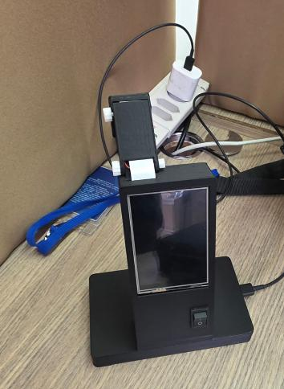

**Status:** Developed as a final-year project at Antonine University (team of two), defended July 2026, grade 90%. I owned the reading pipeline and the backend. Source is private as the project is being developed further. Happy to walk through the system in an interview.

## How it works

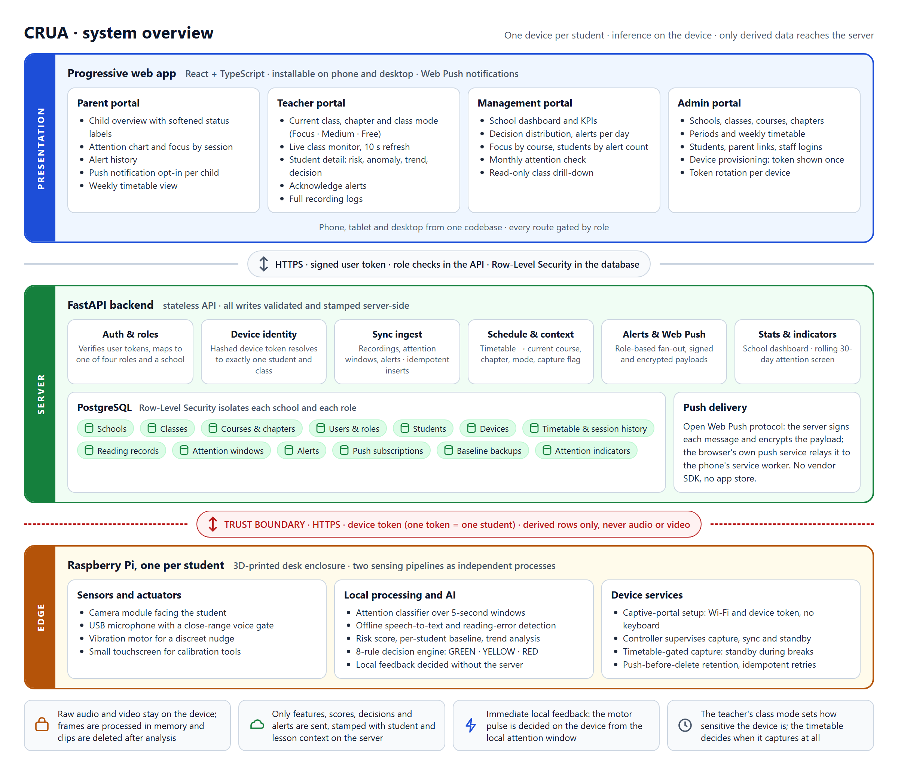

The trust boundary sits between the desk and the server. Everything inside the device box below operates on audio and video; everything outside it only ever sees numbers, labels and short text.

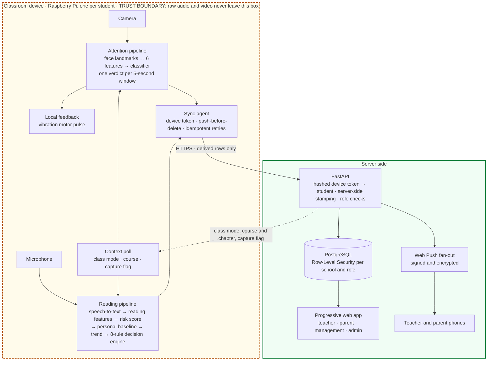

**One session, end to end.** A period begins. The device has been polling the server for context, and the timetable now says this class is in a lesson, so capture switches on and the device picks up the class mode the teacher selected: Focus, Medium or Free. The child reads aloud. The microphone's voice-activity gate opens only for sustained, close-range speech, so a classmate across the room does not trigger it, and it records a variable-length clip that ends when the child stops. On the device, the clip is transcribed offline, reading-error detection and feature extraction produce one fixed-width record, and the clip is deleted. The risk model scores that record. The personal baseline, an anomaly model trained only on this child's own history, says whether the recording is unusual for them. The trend analyser updates whether recent history is improving, stable or worsening. The decision engine then applies its 8 ordered rules to a rolling window of recent recordings and returns GREEN, YELLOW or RED, or "insufficient data" for a child with too little history. The record, scores and decision are pushed to the server with the device's token; nothing else is.

In parallel, the camera pipeline has been classifying focus every five seconds. If the rolling focus ratio drops below what the current class mode allows, the motor on the desk gives a short pulse and a low-focus alert is pushed. On the server, the token is hashed and resolved to exactly one student and class, each row is stamped with the course, chapter, teacher and mode in effect, and inserted idempotently so a retry after a dropped connection never duplicates anything. If the decision flipped to RED, the new alert row fans out as a Web Push to the subscribed phones, the teacher's and the parents'. On the teacher's live monitor, refreshing every ten seconds, the child's tile shows presence, focus and the latest decision, and the RED appears in the warnings panel. The teacher opens the student page, sees the trend and the recorded reason, and acknowledges the alert. The parent sees the same event as a softened label and a suggestion to follow up.

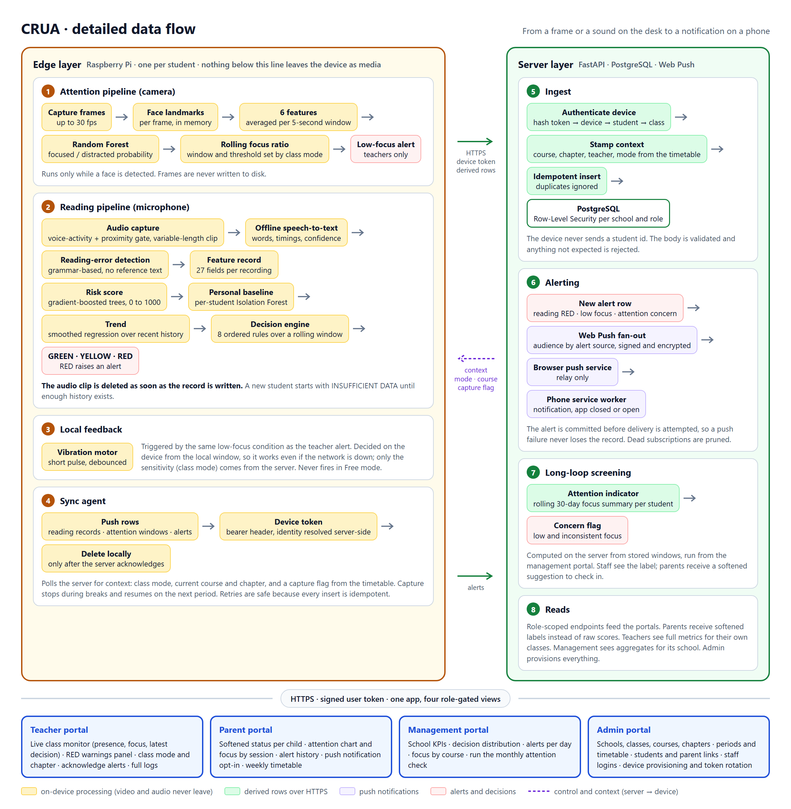

## The two pipelines

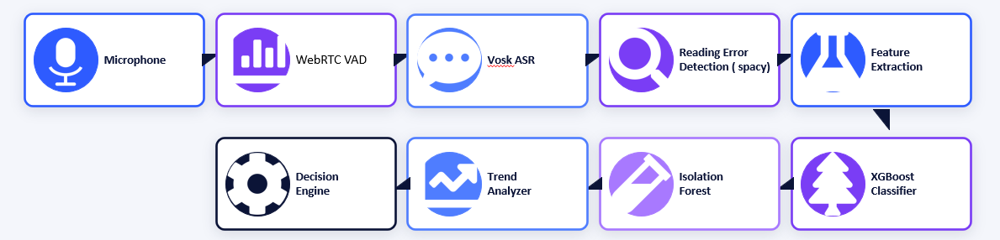

**Reading.** Every stage runs on the device for every recording. A voice-activity and proximity gate records a clip only when the student in front of the device is reading. An offline speech-to-text engine produces words, timings and per-word confidence. A grammar-based reading-error detector works without a reference passage, so it handles free reading rather than a fixed script. Feature extraction writes a 27-field record per recording, of which 13 numeric features feed the model. A gradient-boosted tree regressor turns those features into a risk score from 0 to 1000. A per-student Isolation Forest baseline scores how unusual the recording is for that child, a smoothed linear-regression trend analyser gives direction and confidence over recent history, and an 8-rule decision engine fuses the three signals over a rolling window into GREEN, YELLOW or RED with a recorded reason. The engine never reacts to a single recording.

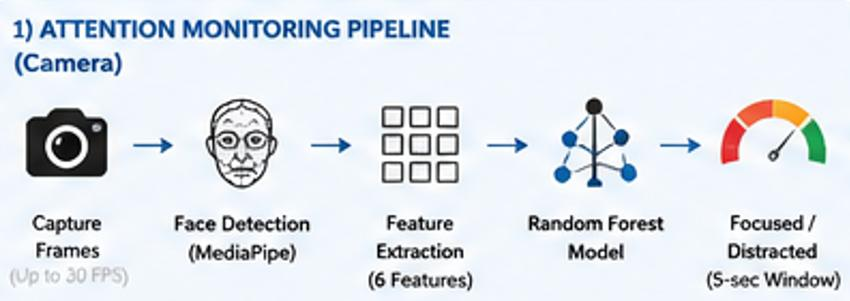

**Attention.** The camera pipeline runs only while a face is detected. Frames are captured at up to 30 frames per second and passed to a face-landmark model in memory. Six features derived from eye, gaze and head-pose landmarks are averaged over each five-second window, and a Random Forest classifier produces a focused or distracted probability for that window. A rolling focus ratio over recent windows, with the window length and threshold set by the teacher's class mode, drives both the local motor pulse and the low-focus alert. Free mode disables both. No frame is ever written to disk.

## Design decisions

**Inference on the device rather than the cloud.** The server never receives material that could identify a child's voice or face, which turns a hard compliance problem into a simple one: there is nothing to leak. It also keeps the local feedback loop independent of network latency and keeps bandwidth trivial, since a session produces a handful of small rows rather than a video stream. The cost is that models must run on a Raspberry Pi, which drove the choice of tree ensembles and a small speech model over neural networks.

**A per-student baseline rather than a single population threshold.** A score that is normal for one child is a warning sign for another. Each student gets an unsupervised anomaly model trained only on their own history, retrained as that history grows, so the system can detect change relative to the child rather than distance from an average. The baseline deliberately detects change, not condition: a child with a stable difficulty looks "normal" to their own baseline, which is exactly why the supervised risk model sits beside it.

**A rule-based decision layer on top of the models.** There are no ground-truth labels for how risk, anomaly and trend should combine, so training a fourth model would mean inventing them. Ordered rules are auditable instead: every decision carries a reason a teacher can read in one sentence, each threshold can be tuned on its own, and more severe states are checked first so a child matching several conditions gets the most concerning one. The engine works on rolling aggregates over many recordings, never on one.

**Trend analysis to separate a bad day from a pattern.** Recent risk scores are smoothed with an exponentially weighted average and fitted with a linear regression. A direction is reported only when the slope is both statistically significant and large enough to matter; otherwise the child is "stable". A single spike in an otherwise flat series stays stable, which was a specific test case, and a gradual decline in a previously fluent reader surfaces before the absolute score becomes alarming.

**Row-Level Security to isolate each school.** Access rules live in the database as policies, not only in application code. A parent can read only linked children, a teacher only students in classes they deliver, management only its own school. Helper functions run with definer rights to avoid recursive policies. The API performs the same checks and uses its privileged role only after it has authenticated a device or a user, so an application bug cannot return another school's rows.

**A progressive web app with push alerts rather than a native app.** One codebase serves phones, tablets and desktops with no app store. Web Push through a service worker delivers notifications with the app closed, including on iOS once the app is installed to the home screen. The open protocol means no vendor SDK and no third-party relay that can read the payload. The app shell is cached for flaky classroom networks while live data is never served stale.

**A vibration motor for low-latency local feedback.** The nudge is decided on the device from the local attention window, so it arrives within the moment of the lapse and keeps working if the network is down. Only the sensitivity, the teacher's class mode, comes from the server. The pulse is short, debounced and never fires in Free mode, so it reads as a discreet reminder rather than a punishment.

## What users see

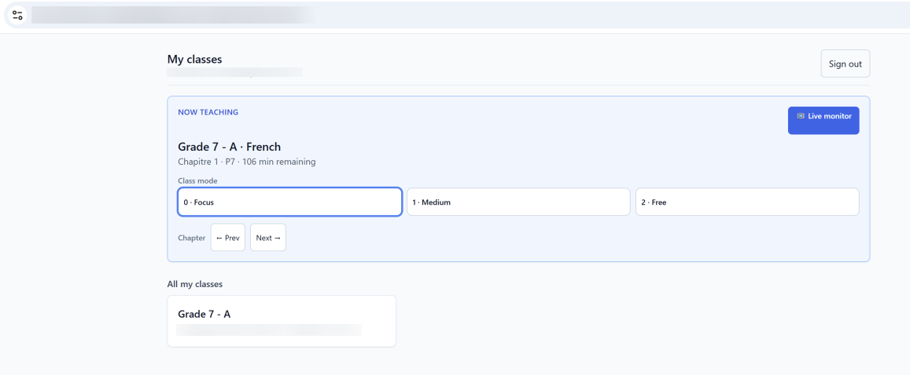

*Teacher portal: current class, chapter and class mode (Focus, Medium, Free), which tunes what the device treats as expected behaviour.*

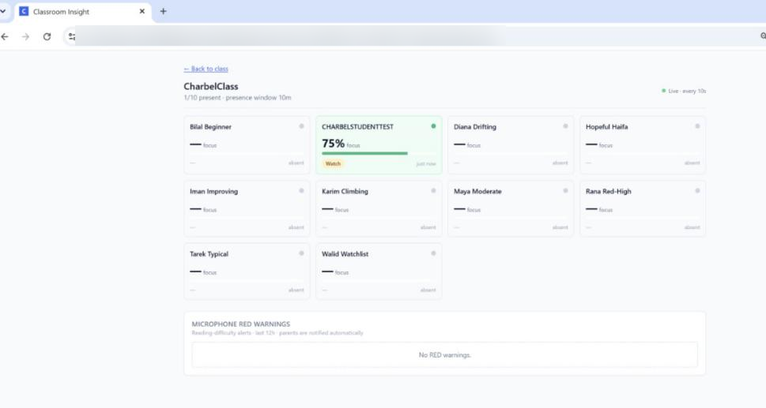

*Live monitor: per-student presence and focus during a session, refreshed every 10 seconds, with reading warnings surfaced in the same view. Student names shown are synthetic test data.*

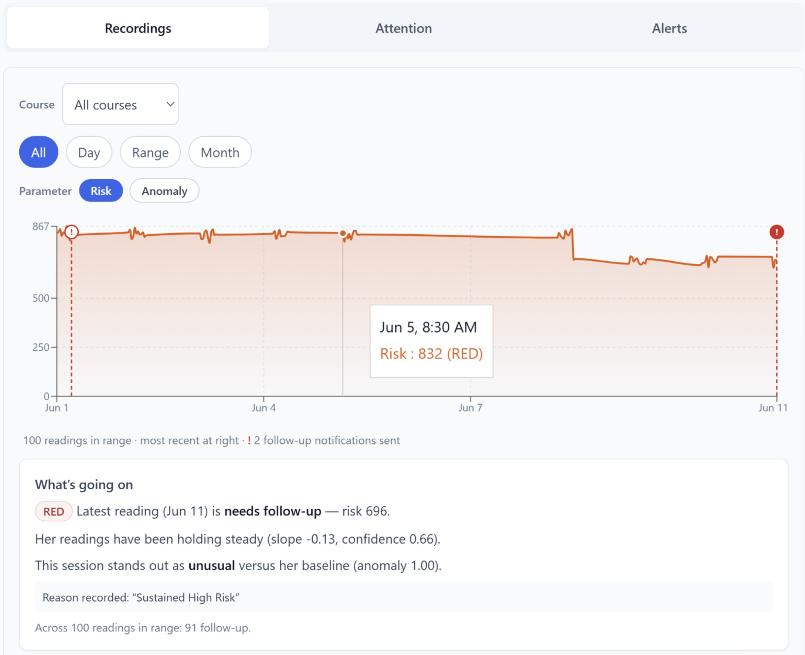

*Reading risk over time for one student, with the latest decision, the trend slope and confidence, and the anomaly score against that student's own baseline.*

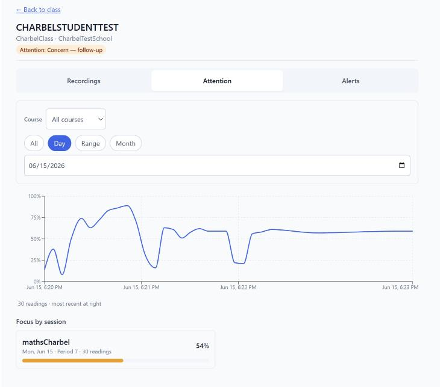

*Attention within one session: focus probability over a short window, with the session summary below.*

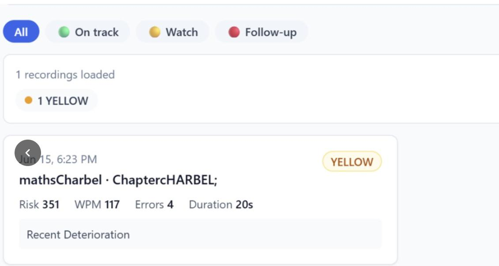

*Alert record for one recording: decision, risk score, reading speed, error count and duration.*

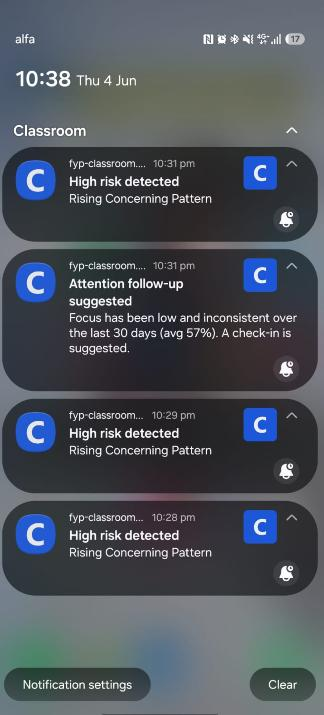

*Web Push notifications on a teacher's phone: high-risk detections and attention follow-up suggestions.*

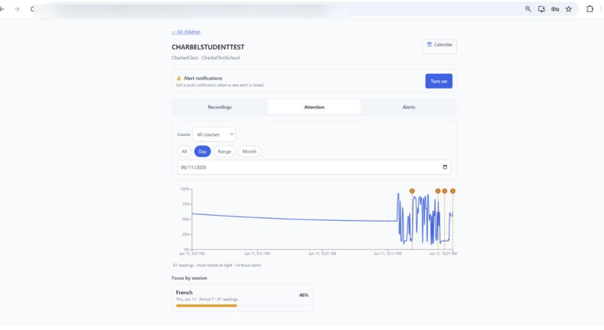

*Parent portal: a softened view of the same signals for one child, with notification opt-in.*

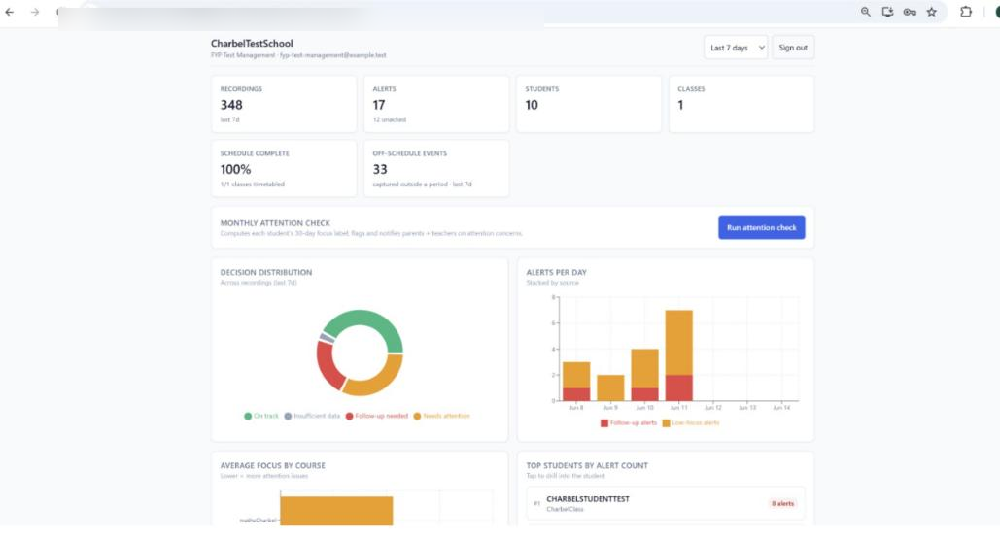

*Management portal: school-level counts, decision distribution, alerts per day, and a monthly attention check across all students.*

## Hardware

| | |
|---|---|
| 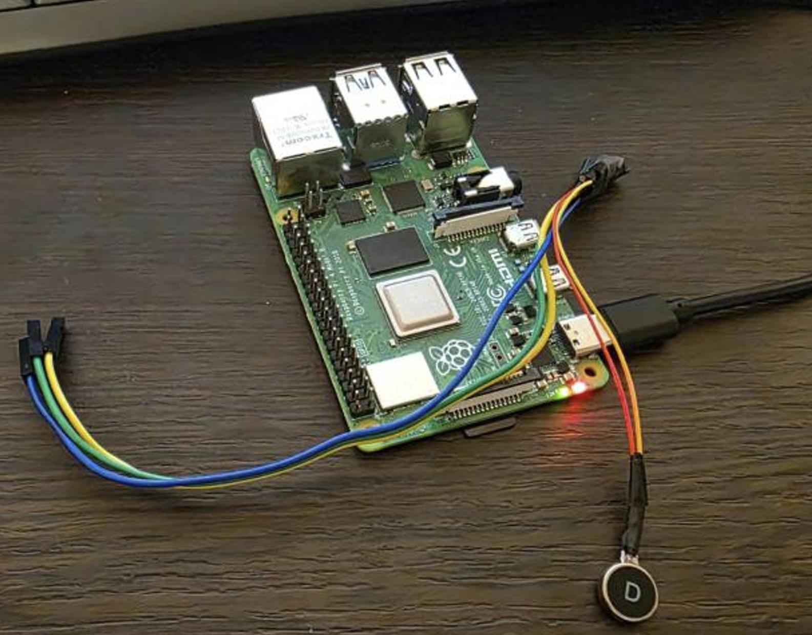 | 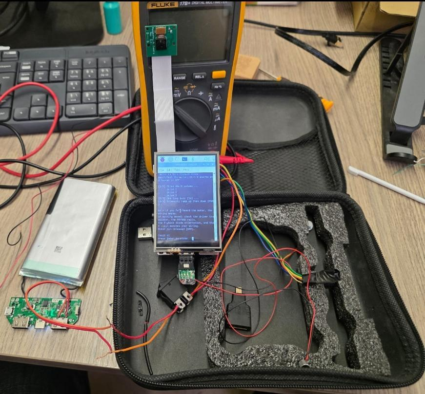 |
| *Raspberry Pi with camera, microphone and vibration motor* | *Bench prototype during calibration* |
| 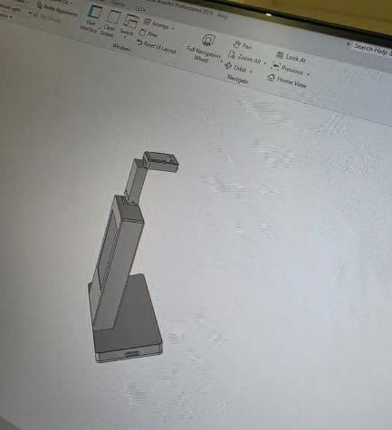 | 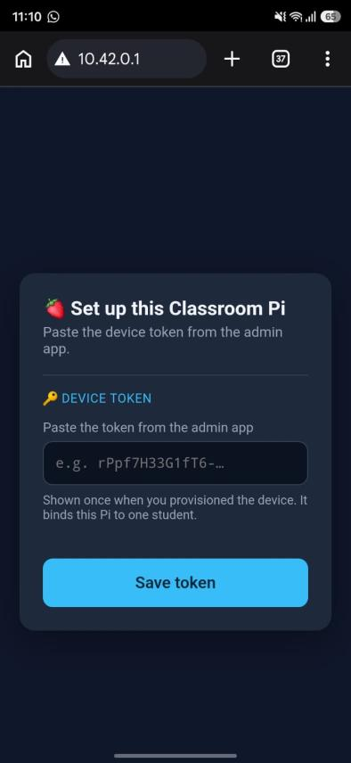 |
| *3D-printed enclosure design* | *On-device setup: the Pi is bound to one student with a device token issued once from the admin portal* |

The device needs no keyboard or monitor to deploy. On first boot it raises its own Wi-Fi access point with a captive portal; a phone joins it, enters the classroom Wi-Fi and the device token, and the device joins the network and starts normal operation. The token is the device's whole identity: the server stores only its hash, resolves it to one student, and can rotate it to cut off a lost device.

## Data model

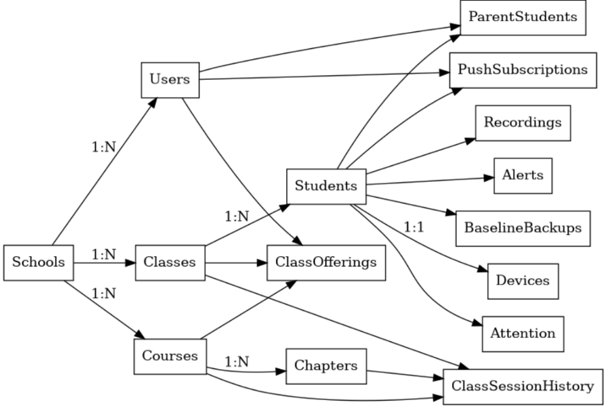

The model has three groups of entities. Organisational entities describe the school: schools, classes, courses and their chapters, users with one of four roles, students, and the device bound one-to-one to a student. Relationship entities record who delivers which course to which class, which parents are linked to which children, the weekly timetable, and an append-only history of every change of session context a teacher makes. Pipeline entities are the append-mostly rows the device produces: reading records, attention windows and alerts, each stamped on the server with the student and the lesson context in effect. Operational entities hold push subscriptions, versioned backups of each student's baseline model so a reflashed device can restore its calibration, and the monthly attention indicators. Every table is under Row-Level Security, so a parent sees only linked children, a teacher only the students in classes they deliver, and management only its own school; nothing crosses a school boundary even if application code has a bug. Students never log in.

## Results

All evaluation data is study data and is not included in this repository. The risk model was trained and tested on synthetic recordings generated from reader personas grounded in published reading-research norms, because labelled recordings of children with reading difficulties cannot be collected within a student project; retraining on real labelled data is the first item on the roadmap.

| What | Result | How it was measured |
|---|---|---|
| Risk model fit (R²) | 0.943 on the held-out test split | Gradient-boosted regressor trained on 840 synthetic recordings, tuned on 180, tested on 180 never seen during training or tuning |
| Risk model error | RMSE 58.1, MAE 43.8 on the 0–1000 scale | Same test split |
| Risk model generalisation | train R² 0.983, validation R² 0.948, 5-fold cross-validated RMSE 67.9 | Grid search with 5-fold cross-validation on the training rows |
| Risk score as a four-band screening decision | accuracy 0.85, weighted F1 0.85 | Test-split scores binned into on-track, watch, moderate and high |
| Per-band F1 | on-track 0.94, high 0.86, watch 0.71, moderate 0.40 | Same split; the moderate band is narrow and had 10 test samples, which is the honest weak spot |
| Personal baseline (anomaly detector) | precision 0.93, recall 0.65, F1 0.77 on the anomaly class; accuracy 0.80 | Trained unsupervised on 80 "normal" recordings of one simulated student, tested on 40 normal and 40 out-of-distribution recordings |
| Decision engine | 8 of 8 scenario tests pass | Built-in scenarios: sustained high risk, rising pattern, one bad day, improving after support, and four edge cases |
| Trend analyser | 5 of 5 scenario tests pass | Including a single spike in a stable series, which must remain "stable" |
| Timetable resolver | 13 unit tests | Pure function, timezone and daylight-saving safe |
| Backend | 8 end-to-end smoke tests | Run against the live API and database |

Two things are deliberately not claimed. The attention classifier was evaluated during development but no held-out figure was recorded in the project artefacts, so none is given here. On-device inference latency was not instrumented; the local feedback path has no server round trip by design, and end-to-end push delivery was observed in the order of seconds but not measured.

## Privacy and ethics

**What the device captures.** Camera frames, processed in memory only while a face is present, and short audio clips recorded only when the voice gate detects sustained, close-range speech.

**What it discards.** Every frame after landmark extraction, and every audio clip as soon as its feature record is written. Nothing captured is stored as media.

**What reaches the server.** Per-recording numeric features, the risk score, anomaly score, trend and decision with its reason, per-window focus probabilities, alert records with their context, timestamps, and the text transcript of what the speech engine heard. The device never sends a student identifier; the server derives it from the hashed device token.

**Retention.** The device keeps a bounded rolling buffer and deletes a row only after the server has acknowledged it, so an outage delays data rather than losing it. The server retains records for the life of the student record; deleting a student cascades to every record about them. Consent records, an access audit log and soft-delete are not yet implemented and are listed on the roadmap as prerequisites for any deployment beyond the prototype.

**Access model.** Three independent layers: a signed token at the door, role checks in the API, and Row-Level Security in the database. Parents see softened labels, never raw scores. Teachers see full metrics for their own classes only. Device tokens are stored as hashes, shown once at provisioning and rotatable. Secrets live only in the hosting environment.

**Ethics.** Every output is a screening signal, never a diagnosis. A RED decision means "this pattern warrants professional assessment"; the same pattern can come from vision, hearing, a second language, anxiety or a recent illness, and the system never names a suspected condition to a parent. Decisions require sustained patterns across many recordings, carry a human-readable reason, and go to a teacher who decides what to do. The models were trained on synthetic data informed by published research and must be re-evaluated on real recordings before any claim about real-world accuracy is made.

## Stack

**Device.** Python on a Raspberry Pi; an offline speech-to-text engine; a natural-language library for tokenisation and part-of-speech tagging; gradient-boosted trees and scikit-learn for the risk, baseline and attention models; a face-landmark model; voice-activity detection; a GPIO library for the motor; a small web framework and the system network manager for the captive portal; one isolated virtual environment per pipeline.

**Backend.** Python with FastAPI and Pydantic; SQLAlchemy; JWT verification; Web Push with VAPID signing and payload encryption; a timezone-aware timetable resolver.

**Database.** PostgreSQL with Row-Level Security, definer-rights helper functions, native enums, partial indexes and plain SQL migrations.

**Frontend.** React with TypeScript, Vite, Tailwind CSS, React Query, React Router, Recharts, Headless UI, and a Workbox service worker extended with a push handler.

**Hosting.** A managed PostgreSQL and authentication provider, a container platform for the API, static hosting on an edge network for the app, all described as code and all on free tiers.

**Hardware.** Raspberry Pi 4, camera module, USB microphone, vibration motor with a driver transistor and flyback diode, 3.5-inch touchscreen for calibration tools, 3D-printed desk enclosure.

## Roadmap

- Retrain the risk model on real labelled recordings when a clinical partnership makes them available, and recalibrate the decision rules against outcomes.
- Add a continuous concern score alongside the discrete GREEN, YELLOW, RED state.
- Notification deep links to the student page, a global notification settings screen, and retry of failed pushes.
- Timetable support for ad-hoc sessions and substitute teachers.
- Let the device trigger the monthly attention check itself.
- Mid-session Wi-Fi recovery on the device.
- Consent records, an access audit log, soft-delete and per-user notification preferences before any deployment beyond the prototype.

## Author

Charbel P. Hajj Moussa · [GitHub](https://github.com/CHM2023) · [LinkedIn](https://www.linkedin.com/in/charbelhajjmoussa7)

All rights reserved. This repository is published for portfolio and review purposes only; see [LICENSE](LICENSE). A longer technical description is in [docs/ARCHITECTURE.md](docs/ARCHITECTURE.md).
